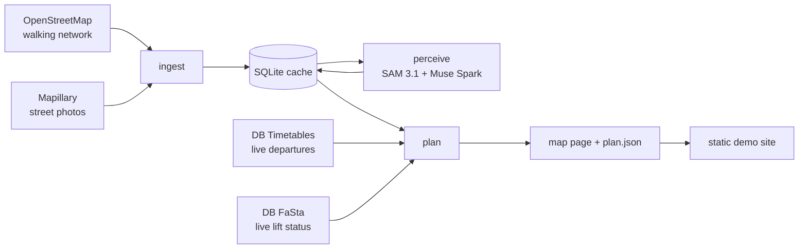

# Barrierefrei

**Step-free trips, checked live.** Barrierefrei plans door-to-door public-transport trips for people
who can't use stairs: wheelchair users, parents with strollers, travellers with heavy luggage. The
walks avoid stairs and high kerbs, and every lift on the way is checked against Deutsche Bahn's live
status before a train is suggested.

It currently covers central Darmstadt and central Frankfurt am Main, connected by S-Bahn and
regional trains.

- Demo site: https://aritra-mukhopadhyay.github.io/barrierfrei/ (trips computed live, then published)
- Video (3 min): <!-- VIDEO_URL -->

## Why

Journey planners show a lift icon at a station, but not whether the lift works right now. When it
doesn't, a wheelchair user is stuck on a platform and has to go back or wait for help. Walking
directions have the same blind spot: they route over kerbs and short flights of steps that the map
doesn't tag. Checking all of this by hand before every trip takes a long time, so many people simply
don't travel spontaneously.

## What it does

For one trip, for example `--from luisenplatz --to zeil --profile wheelchair`:

1. **Walk to a station.** A step-free route on OpenStreetMap paths. It never uses segments tagged as
   steps, and it avoids rough surfaces and segments where street photos show a barrier.
2. **Find trains.** Live departures from DB's Timetables API. By default only trains covered by the
   Deutschlandticket (S-Bahn, RE, RB); `--tickets any` adds ICE, IC and EC.
3. **Check every lift.** Each lift you need, when boarding, changing and arriving, is checked against
   DB's live elevator status (FaSta). A trip through a broken lift is not offered. Frankfurt Hbf's
   main-hall tracks are level with the exits, so they need no lift.
4. **Walk to the destination**, again step-free.

The result is a map page with both walks, the ride, every lift and its status, when to leave, when you
arrive, and why this trip was recommended. Trips are ranked by arrival time, and a trip whose lifts we
could all confirm comes before one we couldn't.

## How the Meta models are used

| Model | Where | What it does |
|---|---|---|
| SAM 3.1 | `barrierfrei/sam.py`, `barrierfrei/perceive.py` | Finds stairs, kerbs, ramps, e-scooters and construction barriers in Mapillary street photos and returns their boxes. |
| Muse Spark (vision) | `barrierfrei/judge.py` | Looks at the photo with SAM's boxes drawn on it and returns schema-checked JSON: the barriers, who can pass (wheelchair, stroller, suitcase), and its confidence. |
| Muse Spark (text) | `barrierfrei/plan.py` (`--explain`) | Explains the chosen trip in plain words. |
| Muse Code | `tools/delegate.py`, `tasks/` | Writes new features from short task specs, each reviewed before it is merged: ten so far, from live DB departures to the demo site (see [How it is built](#how-it-is-built)). |

Safety-critical facts are decided by code, never by a model. Whether a lift works comes from DB's
live data; whether a path has steps comes from OpenStreetMap. A photo verdict can only make a path
more expensive (a detour penalty), and only when the model is at least 70 % confident. It never
clears a path the map says is blocked.

## Architecture



| Module | Role |
|---|---|
| `ingest`, `osm`, `osm_extract`, `mapillary`, `matching`, `store` | Download (or read offline) the walking network and photo metadata, link photos to path segments, cache everything in SQLite. |
| `perceive`, `sam`, `judge`, `images` | Run SAM 3.1 and Muse Spark on photos; results are cached, so re-runs only pay for new photos. |
| `evaluate` | Measure perception against OpenStreetMap ground truth. |
| `routing` | Step-free walking routes with per-profile costs (wheelchair, stroller, suitcase). |
| `transit` | Live departures (DB Timetables, then db.transport.rest), with a typical timetable as the last fallback. |
| `stations` | Live lift status (FaSta) with a short-lived cache. |
| `plan`, `mapview`, `serve`, `site` | Combine everything into ranked trips, render the map page, serve it locally, build the static site. |
| `config` | All settings and secrets in one typed place (`pydantic-settings`); keys are never logged. |

## Honest limits

- Lifts run by VGF (the Frankfurt U-Bahn operator, e.g. the street lifts at Hauptwache and
  Konstablerwache) have no public live data. Trips through them are shown as "OK?" (some parts can't be
  checked), and a trip we could fully verify is preferred.
- Photo perception is evidence, not ground truth. In our evaluation against OpenStreetMap
  (`python -m barrierfrei.evaluate`), Muse Spark flagged about 29 % of photos of tagged steps as not
  wheelchair-passable, so map tags stay the primary source and photos only add penalties.
- Coverage is central Darmstadt and central Frankfurt (two ingested areas). Other areas need an ingest
  first; the planner says so instead of guessing.
- The demo site is a snapshot. Lifts and trains change, so each page says when it was computed.
- There is no hosted live planner yet: the API keys stay on the machine that computes the trips.

## Run it yourself

### Setup

Python 3.11 or newer.

```bash
python -m venv .venv && source .venv/bin/activate   # Windows: .venv\Scripts\activate
pip install -e ".[dev]"
cp .env.example .env   # then fill in the four keys
```

### Keys you need

| Key | Where to get it |
|---|---|
| `MODEL_API_KEY` | dev.meta.ai dashboard: create an API key for the Meta Model API. |
| `MAPILLARY_TOKEN` | mapillary.com: log in, Dashboard, Developers, register an app, copy the **Access Token** (`MLY|...`); the client secret is not needed. |
| `DB_CLIENT_ID`, `DB_API_KEY` | developers.deutschebahn.com: register, create an application, and subscribe it to **FaSta - Station Facilities Status** and **Timetables** (both have a free plan). |

Keys live only in `.env`, which is git-ignored. All code reads them through `barrierfrei/config.py`.

### Quick checks

Each script prints a real result when its key works:

```bash
python hello/01_mapillary.py                       # photos in the demo area, copy one URL
python hello/02_sam.py "<photo url>" "curb"        # SAM 3.1 boxes
python hello/03_spark_vision.py "<photo url>"      # Muse Spark accessibility JSON
python hello/04_voice.py request.wav               # Muse Voice Transcribe
python hello/05_fasta.py                           # Darmstadt Hbf elevator status
```

### Pipeline

| Step | Command | What it does |
|---|---|---|
| 1. Ingest | `python -m barrierfrei.ingest --area darmstadt-centre` (and `--area frankfurt-centre`) | Downloads the OpenStreetMap walking network with accessibility tags and the Mapillary photos in the area, links each photo to its nearest path segment (within 15 m) and caches everything in `data/barrierfrei.sqlite`. |
| 1b. Offline streets | `python -m barrierfrei.osm_extract hessen-latest.osm.pbf --area frankfurt-centre`, then `python -m barrierfrei.ingest --area frankfurt-centre --osm-file data/osm/frankfurt-centre.osm` | When the Overpass API is down: cuts the walkable streets of one area out of a [Geofabrik](https://download.geofabrik.de/europe/germany/hessen.html) extract. Needs `pip install -e ".[offline]"`. |
| 2. Perceive | `python -m barrierfrei.perceive --limit 30` | For each linked photo, SAM 3.1 looks for stairs, kerbs, ramps, e-scooters and construction barriers; Muse Spark then judges the photo with those boxes drawn on it and returns schema-validated JSON (barriers, who can pass, confidence). Results are cached, so re-runs only pay for new photos. |
| 3. Evaluate | `python -m barrierfrei.evaluate --n 20` | Uses OpenStreetMap as ground truth: takes the closest photo of up to 20 `steps` segments and 20 plain footways, perceives any that aren't judged yet, and reports how many steps Spark flags as not wheelchair-passable (recall) and how many footways it wrongly flags. Writes `data/eval/report.csv` with Mapillary links so you can spot-check the labels. |
| 4. Plan a trip | `python -m barrierfrei.plan --from luisenplatz --to zeil --profile wheelchair` | Walks step-free to a station, checks every elevator on the trip against DB's live FaSta data, rides, and walks to the destination. Rejects trips through broken elevators and writes `data/plans/plan.html` (map) and `plan.json`, opening the map in the browser via a local server. `--from`/`--to` take a place name (luisenplatz, darmstadt-hbf, tu-darmstadt, darmstadtium, staatstheater, herrngarten, frankfurt-hbf, hauptwache, zeil, roemer, paulskirche, alte-oper, staedel) or `lat,lon`. Add `--out-of-service <equipment number>` to simulate a broken elevator, `--explain` for a Muse Spark summary, `--no-serve` to only write the files, `--tickets any` to also include ICE, IC and EC. Re-open the last map with `python -m barrierfrei.serve`. |
| 5. Demo site | `python -m barrierfrei.site` (or `--only luisenplatz-zeil`) | Computes the demo trips live and writes their map pages and an index to `site/`. Commit `site/` and GitHub Pages publishes it. |

The covered region is central Darmstadt to central Frankfurt. Settings (keys, areas, model names)
live in `barrierfrei/config.py` and can be overridden in `.env`, e.g. `BBOX=[8.628,49.869,8.653,49.876]`.

## Development

```bash
ruff check . && ruff format --check .   # lint + formatting
pytest -q                               # tests run offline: no network, no keys, no credits
```

Rules for anyone (human or agent) changing the code are in [AGENTS.md](AGENTS.md): settings and
secrets only through `config.py`, offline tests for every behaviour change, and safety-critical
decisions in code rather than in a model. [CONTRIBUTING.md](CONTRIBUTING.md) covers pull requests.

### How it is built

Each change starts as a short spec in `tasks/` (goal, files, exact behaviour, tests, out of scope).
Meta's [Muse Code](https://dev.meta.ai/docs/muse-code) agent writes the code from the spec in its own
sandboxed clone, Claude reviews the diff and runs the checks, and the change lands as a pull request.
`python tools/delegate.py --help` shows the commands, and [CONTRIBUTING.md](CONTRIBUTING.md#task-specs-and-delegated-changes)
describes the loop.

## Roadmap

- More areas along the Rhine-Main S-Bahn network, and a one-command ingest for any German city.
- Live status for VGF lifts and other non-DB operators, as soon as their data is open.
- Better photo perception: a larger labelled evaluation set from OpenStreetMap, and prompts tuned
  against it.
- Live journeys with changes: the live DB Timetables provider returns direct trains only today, and
  U-Bahn and tram connections (outside DB's data) are not covered yet.
- A hosted planner with a small API, so the keys stay on a server instead of a laptop.
- Spoken trip requests ("I have a stroller, take me from Luisenplatz to the main station"); a first
  check with Muse Voice Transcribe is in `hello/04_voice.py`.

## Data and attribution

- Map data © [OpenStreetMap](https://www.openstreetmap.org/copyright) contributors, available under
  the Open Database Licence (ODbL). Map tiles by OpenStreetMap.
- Street photos: [Mapillary](https://www.mapillary.com/), under Mapillary's terms; photos are used for
  analysis and are not redistributed in this repository.
- Live lift status and departures: Deutsche Bahn's FaSta and Timetables APIs via the
  [DB API Marketplace](https://developers.deutschebahn.com/).
- Offline street extracts: [Geofabrik](https://download.geofabrik.de/).

## Background

Barrierefrei was started in October 2026 during the Meta Global AI Developer Hackathon and continues
as an open-source project.

## Licence

MIT, see [LICENSE](LICENSE).
